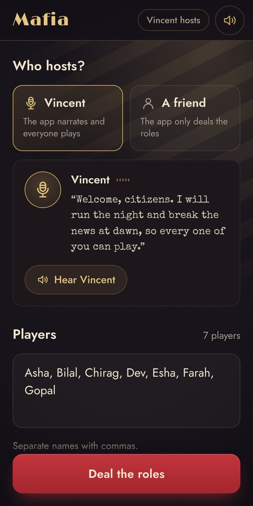
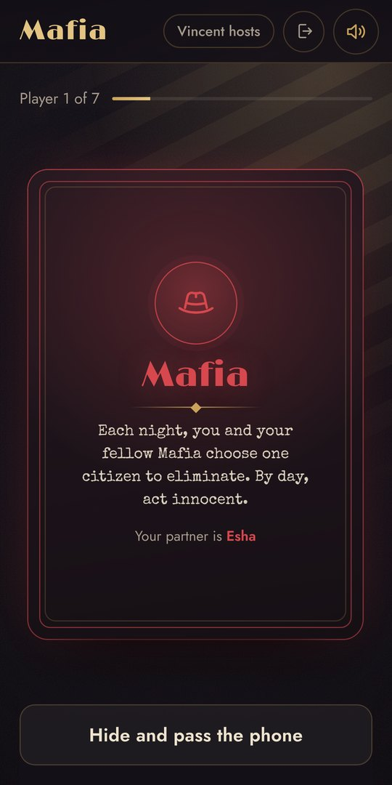
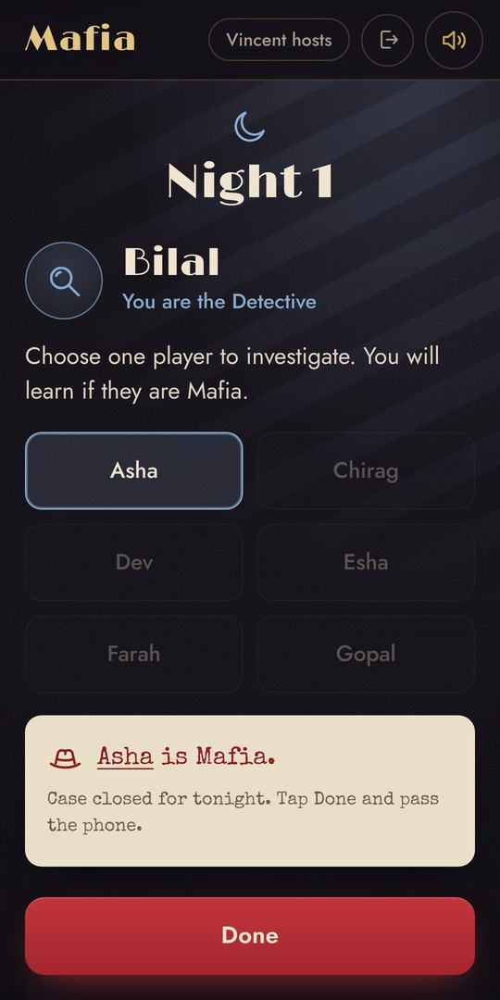
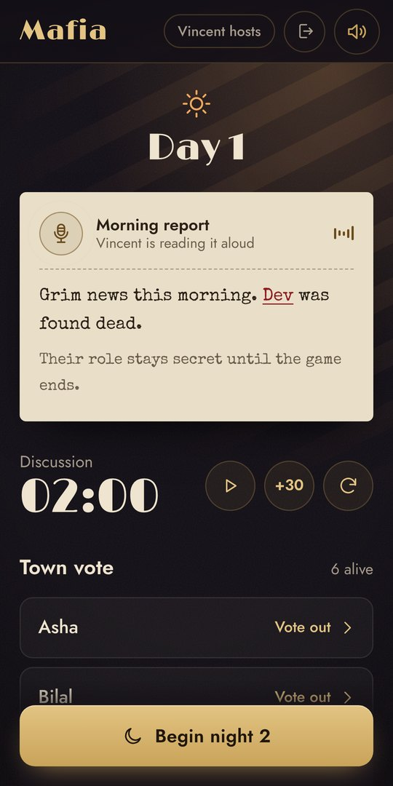
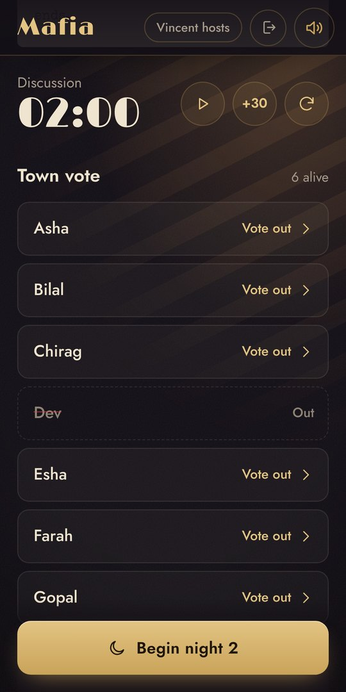
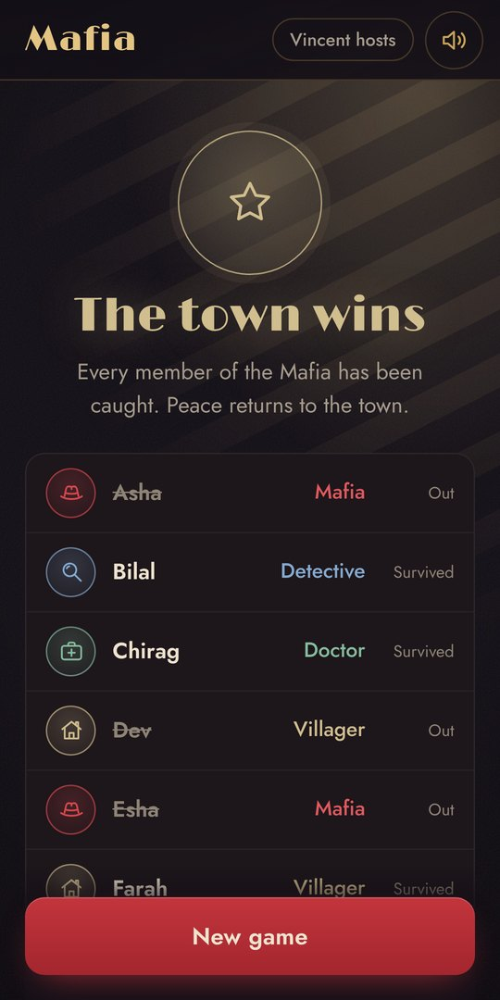
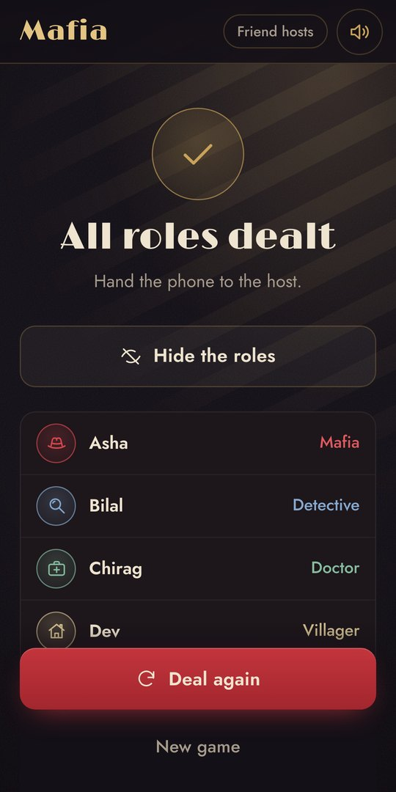
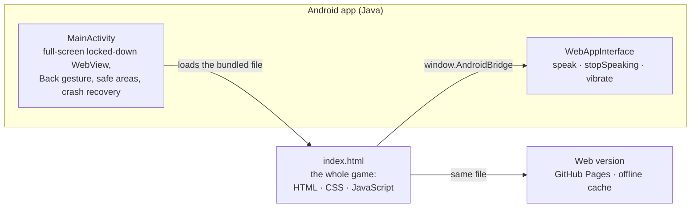

<p align="center">
  
</p>

# Mafia: Party Game Narrator

[](https://github.com/Niyutkumar/mafia-party-game/actions/workflows/tests.yml)
&nbsp;**[▶ Play it in your browser](https://niyutkumar.github.io/mafia-party-game/)**

The classic party game of lies, alibis and accusations, run from a single phone.

Players pass the phone around to see their secret role. Then **Vincent**, the game's narrator, calls each role in turn at night, collects every choice in secret and announces what happened at dawn. Nobody has to sit out as the host.

It ships as an **Android app** (Java + WebView, targets Android 16, being prepared for Google Play) and as an **installable web app** that works offline.

## Screenshots

<p align="center">
  
  
  
  
</p>
<p align="center">
  
  
  
</p>

## Features

- **Two ways to play:** *Vincent hosts* (the app narrates and runs every night) or *A friend hosts* (the app only deals the roles and shows the host who is who)
- **Five roles:** Mafia, Detective, Doctor, Vigilante and Villager, with auto-balance for any group of 4 or more
- **Fair night rules:** the Mafia's majority vote decides the victim, a tie means nobody dies, the Doctor can save the target, and every Vigilante shot counts
- **Mafia partners** see each other on their role card, so they can defend each other by day
- **Spoken narration** through the phone's text-to-speech voice, plus sound effects and haptic feedback
- **Day phase:** morning report, discussion timer (+30 s), town vote, and a full role reveal when the game ends
- **Hold-to-end button** with confirmation, so a stray tap never ends a game
- **1940s film-noir design** that works fully offline

## How it's built



| Part | Technology |
| --- | --- |
| Game | One self-contained HTML/CSS/vanilla JavaScript file: game state and rules engine, five screens, Web Audio sound effects, an inline SVG icon set, embedded fonts. No frameworks, no network calls. |
| Android | Java with only the Android SDK (no third-party libraries): `WebView`, `TextToSpeech`, `Vibrator`, `OnBackInvokedCallback` (predictive back), `WindowInsets` (edge-to-edge). minSdk 24, targetSdk 36. |
| Web | Progressive Web App: a manifest and a network-first service worker make it installable and playable offline. |
| Tests | 16 end-to-end tests with Playwright and axe-core, run by GitHub Actions on every push. |

## Security and privacy

- The Android app's **only permission is vibration**. It has no internet permission, so it can't send data anywhere.
- The WebView is locked to the bundled game: no file or content access, no pop-up windows, no remote debugging, and web links open in the phone's browser.
- A **Content-Security-Policy** blocks outside scripts and network requests.
- App data is excluded from cloud backups and device transfers.
- The app collects **no data at all**. See the [privacy policy](https://niyutkumar.github.io/mafia-party-game/privacy-policy.html).

## Tests

The suite in [`tests/game.spec.js`](tests/game.spec.js) plays real games in Chromium, with a stand-in for the Android bridge, and checks:

- **Night rules:** majority vote, ties (2-way and 3-way), changing your mind, Doctor saves, Vigilante shots, and two Detectives in one game
- **Role cards:** Mafia partners
- **Whole games:** both hosting modes, from dealing the roles to the winner screen
- **Android behaviour:** the Back gesture never skips a game step
- **Security and accessibility:** zero Content-Security-Policy violations, no JavaScript errors, no WCAG 2.1 AA accessibility failures

```bash
npm install
npx playwright install chromium
npm test
```

## Run it yourself

- **Browser:** open the [live version](https://niyutkumar.github.io/mafia-party-game/), or open `index.html` directly.
- **Android:** open the `android/` folder in Android Studio and press Run. The release signing key isn't in this repository; see [`android/README.md`](android/README.md).

## Project structure

```
index.html              the game (copied into the Android app as-is)
manifest.json, sw.js    installable, offline web app
android/                Android Studio project (Java)
tests/game.spec.js      end-to-end tests
privacy-policy.html     privacy policy for Google Play
docs/                   screenshots and banner
```

## Author

**Niyut Shah** · [github.com/Niyutkumar](https://github.com/Niyutkumar)
